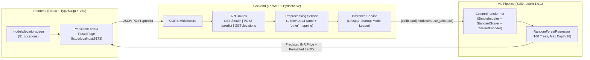
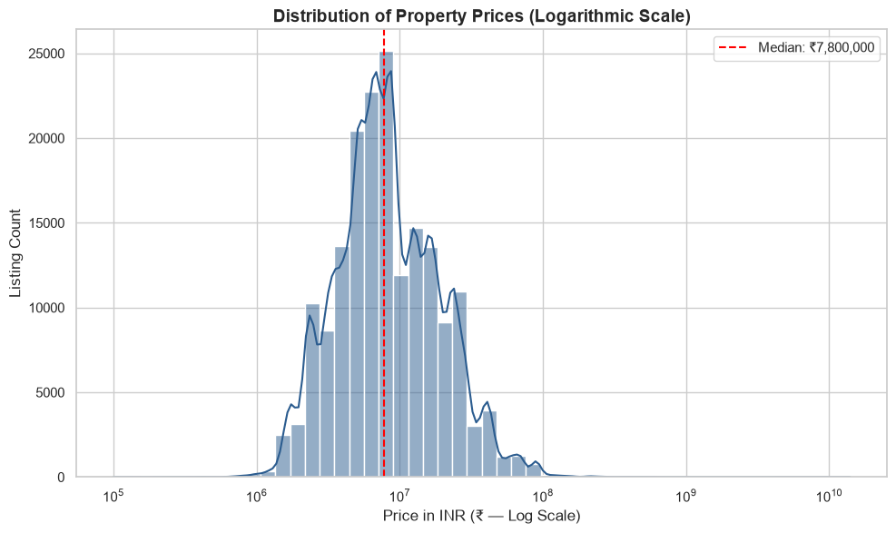
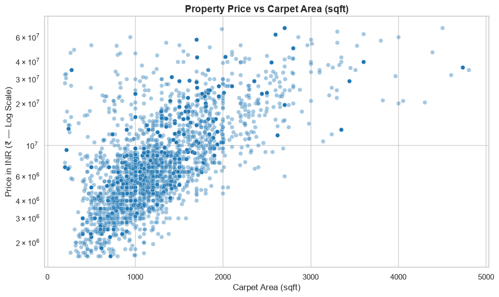
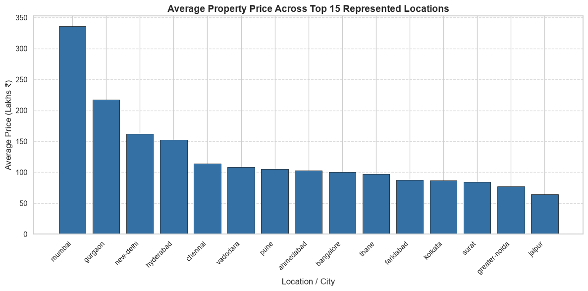
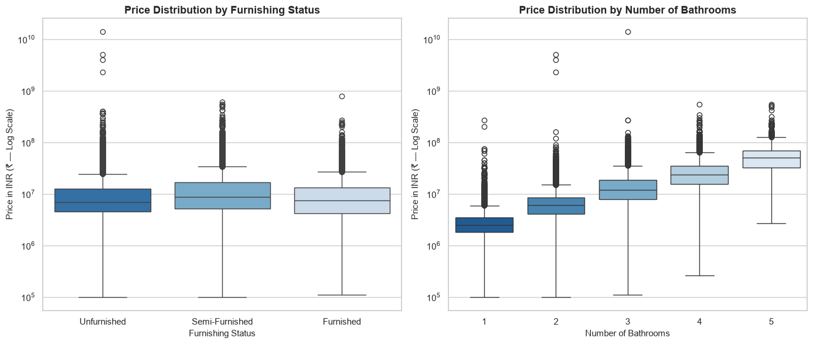
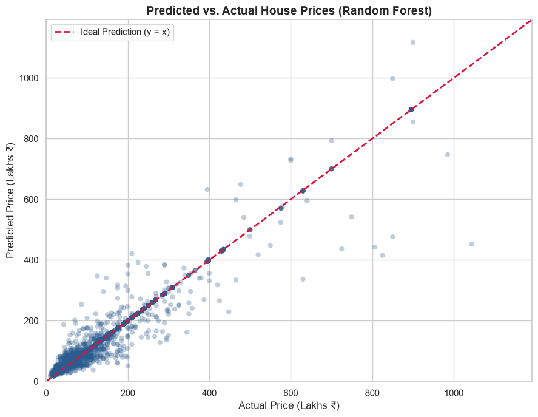

# PropVal AI — End-to-End Indian House Price Prediction ML Web Application

An end-to-end, production-minded machine learning web application that estimates residential property market prices across India. Built from raw real estate listing data through data cleaning, exploratory data analysis (EDA), scikit-learn pipeline modeling, a FastAPI inference server, and a modern React + TypeScript + Vite web interface.

---

## Table of Contents

- [Project Overview & Problem Statement](#project-overview--problem-statement)
- [System Architecture](#system-architecture)
- [Technology Stack](#technology-stack)
- [Project Structure](#project-structure)
- [Dataset Source & Download Instructions](#dataset-source--download-instructions)
- [Data Cleaning & Feature Engineering](#data-cleaning--feature-engineering)
- [Exploratory Data Analysis (EDA) Highlights](#exploratory-data-analysis-eda-highlights)
- [Model Comparison & Evaluation](#model-comparison--evaluation)
- [Installation & Local Setup](#installation--local-setup)
- [Environment Variables](#environment-variables)
- [API Reference & Example Requests](#api-reference--example-requests)
- [Running Tests & Production Builds](#running-tests--production-builds)
- [Visualizations & Application Preview](#visualizations--application-preview)
- [Future Improvements](#future-improvements)

---

## Project Overview & Problem Statement

Real estate pricing in India varies widely by city, locality, carpet area, configuration, furnishing status, and ownership type. Raw property listings from online portals are notoriously unstandardized: prices are written in mixed units (`"42 Lac"`, `"1.2 Cr"`, `"Call for Price"`), areas appear in both `sqft` and `sqm`, floor values include text like `"Ground out of 4"` or `"10 out of 11"`, and extreme pricing outliers skew naive models.

**Objective:** Build a reproducible, leakage-free machine learning pipeline that transforms raw property listings into accurate price predictions (`₹ INR`), and expose that pipeline through a validated FastAPI REST API consumed by a responsive, accessible React + TypeScript application.

---

## System Architecture



---

## Technology Stack

| Layer | Technologies |
| :--- | :--- |
| **Machine Learning & Data** | Python 3.12, Pandas 3.1.1, NumPy, Scikit-Learn 1.9.1, Joblib 1.6.0, Matplotlib, Seaborn |
| **Backend API** | FastAPI, Uvicorn, Pydantic v2, Pydantic-Settings, Pytest, HTTPX |
| **Frontend UI** | React 19, TypeScript, Vite 8, React Router v7, Modern CSS |
| **Containerization & Ops** | Docker (Backend), Environment-driven configuration (`.env`) |

---

## Project Structure

```text
house-price-prediction/
├── backend/
│   ├── app/
│   │   ├── api/routes/
│   │   │   └── prediction.py       # GET /health, GET /locations, POST /predict
│   │   ├── core/
│   │   │   └── config.py           # Pydantic-settings environment configuration
│   │   ├── schemas/
│   │   │   └── prediction.py       # Request & Response schemas with validation
│   │   ├── services/
│   │   │   ├── inference.py        # Lifespan model loader & prediction execution
│   │   │   └── preprocessing.py    # 1-row DataFrame builder & INR formatting
│   │   ├── utils/
│   │   │   └── logging_config.py   # Structured logging configuration
│   │   └── main.py                 # FastAPI app, lifespan & CORS configuration
│   ├── models/
│   │   ├── house_price.pkl         # Trained Scikit-Learn Pipeline (25.41 MB)
│   │   └── locations.json          # 51 allowed locations ('other' + top 50)
│   ├── tests/
│   │   └── test_prediction.py      # Pytest suite (7 automated integration tests)
│   ├── .env.example
│   ├── Dockerfile
│   └── requirements.txt            # Pinned dependencies (scikit-learn==1.9.1)
├── frontend/
│   ├── src/
│   │   ├── api/
│   │   │   └── predictionClient.ts # Typed fetch wrapper using VITE_API_BASE_URL
│   │   ├── components/
│   │   │   └── PredictionForm.tsx  # Accessible form with client-side validation
│   │   ├── data/
│   │   │   └── locations.json      # Synced location dropdown options
│   │   ├── pages/
│   │   │   ├── HomePage.tsx        # Property specification input page (/)
│   │   │   ├── ResultPage.tsx      # Formatted INR valuation summary (/result)
│   │   │   └── NotFoundPage.tsx    # Custom 404 page (*)
│   │   ├── types/
│   │   │   └── prediction.ts       # TypeScript types mirroring backend schemas
│   │   ├── App.tsx                 # Router & health status indicator
│   │   ├── App.css
│   │   └── index.css
│   ├── .env.example
│   └── package.json
├── models/
│   ├── house_price.pkl             # Primary exported model artifact
│   └── locations.json              # Primary exported location list
├── notebooks/
│   ├── data/                       # Place house_prices.csv here (excluded from Git)
│   └── house_price_model.ipynb     # Full executable ML analysis & training report
├── docs/
│   └── images/                     # Exported EDA and evaluation charts
├── .gitignore
└── README.md
```

---

## Dataset Source & Download Instructions

- **Dataset:** [House Price by Juhi Bhojani (Kaggle)](https://www.kaggle.com/datasets/juhibhojani/house-price)
- **File:** `house_prices.csv` (~187,531 rows, 21 columns, ~106 MB)

> **Note:** Raw CSV files are excluded from Git via `.gitignore`. Follow either option below before running the Jupyter notebook.

### Option A — Kaggle CLI (Recommended)
```bash
pip install kaggle
# Place your kaggle.json token in ~/.kaggle/ (macOS/Linux) or C:\Users\<you>\.kaggle\ (Windows)
kaggle datasets download -d juhibhojani/house-price -p notebooks/data --unzip
```

### Option B — Manual Download
1. Visit [https://www.kaggle.com/datasets/juhibhojani/house-price](https://www.kaggle.com/datasets/juhibhojani/house-price).
2. Click **Download** and extract `house_prices.csv`.
3. Place the CSV file inside `notebooks/data/house_prices.csv`.

---

## Data Cleaning & Feature Engineering

All cleaning steps are documented and executed in [`notebooks/house_price_model.ipynb`](notebooks/house_price_model.ipynb):

1. **Currency Parsing:** Converted `Amount(in rupees)` strings (`"42 Lac"` $\rightarrow 4.2 \times 10^6$, `"1.40 Cr"` $\rightarrow 1.4 \times 10^7$) to numerical INR; removed 9,684 unpriced listings (`"Call for Price"`).
2. **Area Standardization:** Extracted numeric areas and normalized `sqm` / `m²` values to square feet ($1\text{ sqm} \approx 10.764\text{ sqft}$). Because `Carpet Area` and `Super Area` are mutually exclusive in this dataset, `Super Area` serves as a clean fallback when `Carpet Area` is missing.
3. **Floor Extraction:** Parsed strings like `"10 out of 11"`, mapping `"Ground"` $\rightarrow 0$ and `"Basement"` $\rightarrow -1$.
4. **Numeric Conversion:** Extracted numeric counts from `Bathroom` and `Balcony` (handling string annotations like `"> 10"`).
5. **High-Cardinality Location Grouping:** Kept the **top 50 locations** (covering **98.32%** of listings) and mapped remaining rarer locations to `"other"` (51 classes total).
6. **Outlier Filtering:** Retained carpet areas between `100` and `10,000` sqft and filtered `price_per_sqft` between the **1st percentile (₹2,291/sqft)** and **99th percentile (₹101,504/sqft)**, yielding **171,556** clean records.
7. **Pipeline Encapsulation:** Bundled `SimpleImputer` (median/most_frequent), `StandardScaler`, and `OneHotEncoder(handle_unknown="ignore")` inside a single scikit-learn `ColumnTransformer` + `Pipeline` to guarantee zero data leakage and identical train/inference transformations.

---

## Exploratory Data Analysis (EDA) Highlights

- **Skewed Target Distribution:** Property prices span orders of magnitude from ₹3.6 Lac to multi-crore estates, with a median around ₹78 Lac (`price_clean`).
- **Area vs. Price:** Strong positive trend between carpet area and total price, with city premiums creating vertical dispersion.
- **Location Impact:** Metropolitan markets like Mumbai, Gurgaon, and New Delhi command markedly higher average prices than Tier-2 cities.
- **Configuration Premiums:** Prices rise steadily with bathroom count (1 to 5 bathrooms) and show premiums for furnished/semi-furnished units.

| Price Distribution (Log Scale) | Price vs. Carpet Area |
| :---: | :---: |
|  |  |

| Top 15 Locations Average Price | Price by Furnishing & Bathrooms |
| :---: | :---: |
|  |  |

---

## Model Comparison & Evaluation

Models were trained on an **80/20 train/test split** (`137,244` train / `34,312` test, `random_state=42`) and evaluated strictly on the held-out test set:

| Model | MAE (₹) | RMSE (₹) | $R^2$ Score | Artifact Size |
| :--- | :---: | :---: | :---: | :---: |
| Linear Regression (Baseline) | ₹4,561,980 | ₹7,779,890 | 0.6389 | — |
| Gradient Boosting Regressor (`n_estimators=100, max_depth=6`) | ₹1,896,263 | ₹4,220,266 | 0.8937 | 0.80 MB |
| **Random Forest Regressor (`n_estimators=100, max_depth=16, min_samples_leaf=4`)** | **₹1,292,438** | **₹3,950,776** | **0.9069** | **25.41 MB** |

### Final Model Selection
The **Random Forest Regressor Pipeline** was selected as the production model. It achieves the highest test-set $R^2$ (**0.9069**) and lowest MAE (**₹12.92 Lac**), reducing absolute prediction error by **71.7%** over the linear baseline. Constraining `max_depth=16` and `min_samples_leaf=4` prevents overfitting (confirmed by a 5-fold CV $R^2$ of **0.8566 ± 0.0316**) while keeping the serialized `house_price.pkl` artifact at **25.41 MB** (well under the 50 MB limit).



---

## Installation & Local Setup

### Prerequisites
- **Python:** 3.11+ (Tested on Python 3.12.8)
- **Node.js & npm:** Node 18+ (Tested on Node v24.12.0 / npm 11.6.2)
- **Git**

### 1. Clone the Repository
```bash
git clone <your-repository-url>
cd house-price-prediction
```

### 2. Backend Setup (FastAPI)

**Windows (PowerShell):**
```powershell
python -m venv .venv
.venv\Scripts\Activate.ps1
cd backend
pip install -r requirements.txt
Copy-Item .env.example .env
uvicorn app.main:app --reload
```

**macOS / Linux:**
```bash
python3 -m venv .venv
source .venv/bin/activate
cd backend
pip install -r requirements.txt
cp .env.example .env
uvicorn app.main:app --reload
```

The backend API runs on **`http://localhost:8000`**. Interactive Swagger documentation is available at **`http://localhost:8000/docs`**.

### 3. Frontend Setup (React + TypeScript + Vite)

Open a second terminal:
```bash
cd frontend
npm install
# Create .env from example (Windows PowerShell: Copy-Item .env.example .env)
cp .env.example .env
npm run dev
```

The frontend runs on **`http://localhost:5173`**.

---

## Environment Variables

### Backend (`backend/.env`)
| Variable | Default | Description |
| :--- | :--- | :--- |
| `PROJECT_NAME` | `"House Price Prediction API"` | API display title in OpenAPI docs |
| `VERSION` | `"1.0.0"` | Service semantic version |
| `MODEL_PATH` | `"models/house_price.pkl"` | Path to exported joblib pipeline |
| `LOCATIONS_PATH` | `"models/locations.json"` | Path to allowed location whitelist JSON |
| `CORS_ORIGINS` | `["http://localhost:5173"]` | Allowed frontend origins for CORS |
| `LOG_LEVEL` | `"INFO"` | Logging level (`DEBUG`, `INFO`, `WARNING`, `ERROR`) |

### Frontend (`frontend/.env`)
| Variable | Default | Description |
| :--- | :--- | :--- |
| `VITE_API_BASE_URL` | `http://localhost:8000` | Base URL for the FastAPI inference server |

---

## API Reference & Example Requests

| Endpoint | Method | Description |
| :--- | :---: | :--- |
| `/health` | `GET` | Health probe returning `{"status": "ok", "version": "1.0.0", "model_loaded": true}` |
| `/locations` | `GET` | Returns sorted JSON array of supported locations (`locations.json`) |
| `/predict` | `POST` | Accepts property specifications and returns predicted INR price + formatted Lac/Cr string |
| `/docs` | `GET` | Interactive Swagger UI |

### Example `curl` Prediction Request

**Bash (macOS/Linux):**
```bash
curl -X POST "http://localhost:8000/predict" \
  -H "Content-Type: application/json" \
  -d '{
    "location": "mumbai",
    "carpet_area_sqft": 1000.0,
    "floor_num": 5,
    "bathroom": 2,
    "balcony": 1,
    "furnishing": "Semi-Furnished",
    "transaction": "Resale",
    "ownership": "Freehold",
    "facing": "East"
  }'
```

**PowerShell (Windows):**
```powershell
Invoke-RestMethod -Uri "http://localhost:8000/predict" -Method Post -ContentType "application/json" -Body '{
  "location": "mumbai",
  "carpet_area_sqft": 1000.0,
  "floor_num": 5,
  "bathroom": 2,
  "balcony": 1,
  "furnishing": "Semi-Furnished",
  "transaction": "Resale",
  "ownership": "Freehold",
  "facing": "East"
}'
```

**Example Response (`200 OK`):**
```json
{
  "predicted_price": 30756974.19,
  "formatted_price": "₹ 3.08 Cr",
  "currency": "INR",
  "status": "success"
}
```

---

## Running Tests & Production Builds

### Backend Integration Tests (`pytest`)
```bash
cd backend
pytest -v
```
Tests cover health check, startup model initialization, successful predictions, unknown location fallback to `"other"`, invalid area (`422`), missing required fields (`422`), and `/locations` metadata.

### Frontend Production Build & Lint
```bash
cd frontend
npm run lint
npm run build
```

---

## Visualizations & Application Preview

- **Home View (`/`):** Responsive, accessible valuation form featuring dynamic location dropdown populated from `locations.json`, client-side validation after interaction, live backend health badge, and loading state indicators.
- **Result View (`/result`):** Displays formatted Indian Rupee valuation (`₹ Lac` / `₹ Cr`), exact INR amount, estimated rate per sqft, and complete property summary cards.
- **404 View (`*`):** Graceful fallback navigation back to the valuation form.

---

## Future Improvements

1. **Hyperparameter Optimization & Gradient Boosted Trees:** Experiment with LightGBM / XGBoost with `TransformedTargetRegressor(func=np.log1p, inverse_func=np.expm1)` for tighter tail accuracy on ultra-luxury properties.
2. **Prediction Confidence Intervals:** Compute quantile prediction intervals (10th–90th percentile across forest trees) to display an estimated valuation range rather than a single point estimate.
3. **NLP Feature Extraction:** Extract structured amenity flags (e.g., swimming pool, gated community, metro proximity) from `Title` and `Description` columns.
4. **Docker Compose Deployment:** Add a root `docker-compose.yml` orchestrating the FastAPI container and an Nginx-served production frontend build.

